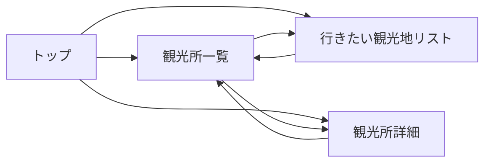
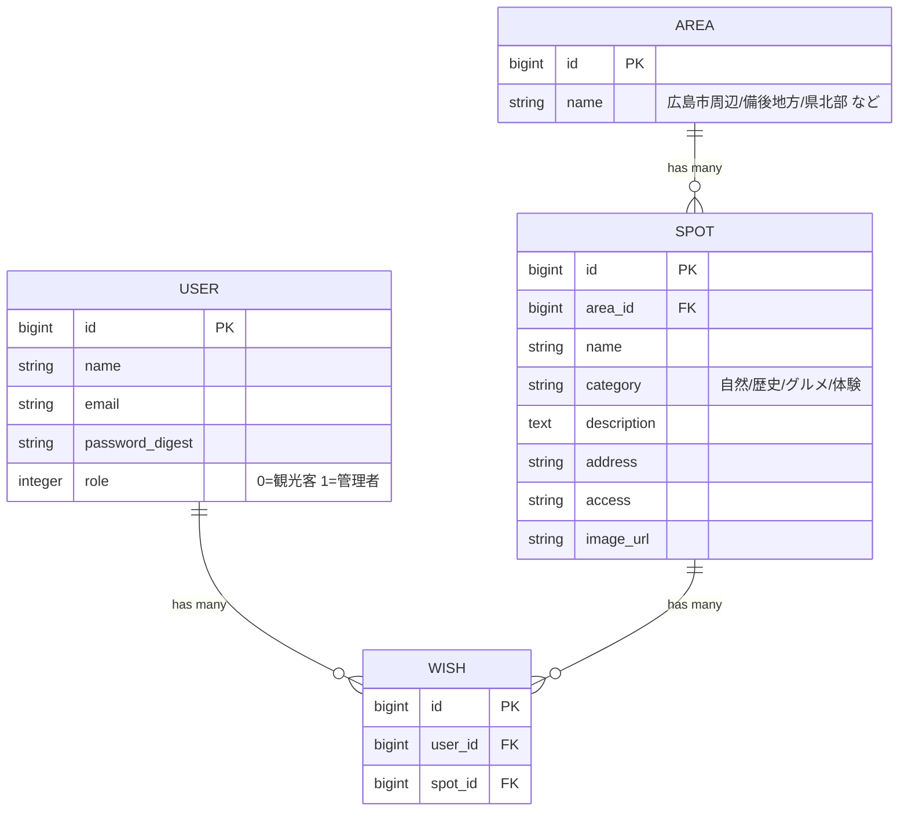

# 基本設計書：

- チーム番号：チーム08
- メンバー：2411140032半山光月、2411140051村田颯

## 課題
- **選んだ課題**：-宮島・原爆ドーム以外にも、素晴らしい観光地がたくさんあるので広めたい！！
- **誰の課題か**：広島県
- **なぜこの課題を選んだか**：宮島・原爆ドームの観光客が増加する一方で、その他の観光地への人の流れが少ないから。
- **元になった自治体課題**：広島県

## 0. 考えを整理する3つの問い
- **開発目的**：宮島・原爆ドームだけでなくその他の魅力的な観光地にも足を運んでもらう
- **想定ユーザ**：観光客、役所の人
- **機能**：観光名所紹介ページ、ここに行きたい（いいね）ボタン

## 1. ユーザーストーリー
- ストーリー1：観光客として、宮島・原爆ドーム以外の広島の観光地を一覧で探したい。なぜなら、有名な2か所以外に何があるか知らないから。
- ストーリー2：県の担当者として、観光地の情報を追加・編集したい。なぜなら、新しい観光地や最新の情報を発信し続けたいから。

## 2. 画面イメージ（ワイヤーフレーム）

## 3. ページ遷移図

## 4. データモデル（ER図）

- 各テーブルには Rails が `created_at` / `updated_at` を自動で追加する（図では省略）。
- 関連は、Area（1）：Spot（多）、User（1）：Wish（多）、Spot（1）：Wish（多）。
- Wish は User と Spot をつなぐ中間テーブル。外部キーは Wish 側が持つ。
- 同じ人が同じ観光地を2回押せないよう、`wishes`に`[user_id, spot_id]`のユニークインデックスを付ける。

## 5. 開発着手の許可基準に対する自己チェック
- [x] 課題の具体性：広島県の「宮島・原爆ドームに観光客が集中し、その他の観光地への人の流れが少ない」という現在の課題に基づいている。
- [x] 連動性：ユーザーストーリー1・2（知らない、充実させたい）は`spots#index/show`と`wishes#index`に、ストーリー3（広めたい）は`admin/dashboard`と Wish の集計に対応している。
- [ ] ボリュームの妥当性：画面5つ・モデル4つ。Rails の scaffold と`has_secure_password`でログインまで作れるため、第14回までに収まるか、チームで確認する。
